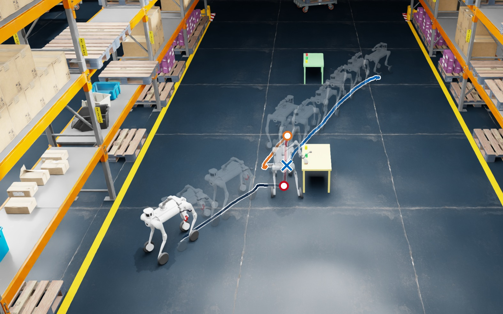

# Application scenarios for a quadruped manipulator in NVIDIA Isaac Sim

A Unitree **B2W** wheeled quadruped with a **Z1** arm and gripper, simulated in NVIDIA Isaac Sim with the sensors
planned for the real robot, and a pipeline that goes from a sentence to a fetched box: *"Pick up the red box on the
yellow table and bring it to me."* DualVLN walks the robot to the named table, Nav2 parks it beside the box, the arm
picks the box up, Nav2 brings it back, and every episode can be recorded as a LeRobot dataset for training a
whole-body vision-language-action model.



*One episode of the final pipeline as a chronophotograph (see `docs/report.pdf`, Fig. 1).*

Forschungspraktikum at the TUM AVS lab, 2026. The report with all results is [`docs/report.pdf`](docs/report.pdf).

## What is in here

- **The robot.** B2W + Z1 + gripper as one articulation (23 DoF), RealSense D455 (head) and D405 (wrist, on a
  3D-printable holder), Ouster OS0-128 lidar, all publishing to ROS 2. Built by scripts in `tools/`.
- **Controllers.** ETH's walking policy for the real B2W with our stance fine-tune; whole-body RL policies trained in
  Isaac Lab, up to one policy that drives, crouches and reaches a 6D hand target by itself (`policies/`).
- **Scenarios.** Warehouse scenes with one table or three coloured tables, described by scene files (`scenes/`).
- **Pipelines.** Scripted, Nav2 and language (DualVLN) navigation; side pick with inverse kinematics; delivery.
- **Data.** A recorder for every episode (RGB-D of both cameras, language, 63-D state, whole-body actions, labels) and
  a converter to LeRobot v2.1.
- **Photoreal rooms.** One command from phone photos to a NuRec scene for Isaac Sim (`reconstruction/`).

## Layout

```
config.example.yaml  machine settings (GPU, paths, ports); setup.sh copies it to config.yaml, which you edit
setup.sh             one-time setup: third-party code at pinned versions, our tasks, images, robot assets
run.py               one entry point for everything below
isaac/               Isaac Sim / Isaac Lab infrastructure: launchers, container settings, Dockerfile
project/             the application: fetch pipeline, live demos, recorder, controllers' glue, Nav2/DualVLN clients
training/            our Isaac Lab tasks (installed into robot_lab by setup.sh) and training helpers
evaluation/          the scripts behind the report's numbers
scenes/              scene files: what is where in the world, which Nav2 map, where the robot starts
policies/            trained checkpoints used by the demos
eth/                 ETH's walking controller and our fine-tuned version
nav2/                Nav2 container, parameters, maps
vln/                 DualVLN server container
robots_usd/          robot assets (downloaded by setup.sh; too large for git)
tools/               robot asset builders, dataset tools
reconstruction/      phone photos -> photoreal Isaac Sim scene
docs/                the report and the development records
renders/, datasets/  outputs of runs (not in git)
repos/               third-party checkouts (not in git; cloned by setup.sh)
```

## Requirements

- Linux with an NVIDIA RTX GPU (developed on an RTX 6000 Ada, 48 GB; driver 570) and Docker with the NVIDIA
  container toolkit. Isaac Sim's requirements apply: about 30 GB for the images.
- Language navigation additionally runs DualVLN next to the simulator: about 21 GB of GPU memory (10 GB in 8-bit).
- `git`, `python3` with PyYAML on the host.

## Setup

```bash
git clone <this repository> && cd <it>
./setup.sh                 # creates config.yaml, clones Isaac Lab 2.3.2 + robot_lab 2.3.2, links our tasks in,
                           # builds the isaac-lab and Nav2 images, gets the robot assets
nano config.yaml           # at least gpu.uuid on a shared machine, livestream.address for remote viewing
./setup.sh --vln           # language navigation: InternNav, the DualVLN image and model weights (~16 GB)
./setup.sh --check         # what is there and what is missing
```

The robot assets are not in git (174 MB): `setup.sh` downloads them from the release
(`ASSETS_URL=<release tarball> ./setup.sh`) or copies them (`./setup.sh --assets-from <folder>`).

## Run

```bash
python3 run.py fetch                     # the final pipeline, headless: DualVLN -> Nav2 -> pick -> (delivery)
python3 run.py fetch --episodes 30 --record my_data      # ... and record 30 episodes
python3 run.py dataset my_data --out my_data             # -> datasets/lerobot/my_data (LeRobot v2.1)
python3 run.py fetch --scene warehouse_one_table --no-vln --no-nav2 --deliver   # scripted, one table
python3 run.py live fetch                # Isaac Sim window: type tasks ("go to the green table and pick the red box")
python3 run.py live goto_mine            # one whole-body policy: type a hand target "x y z [roll pitch yaw]"
python3 run.py train --task RobotLab-Isaac-RFM-Delta-Sphere-Unitree-B2W-Z1-v0    # RL training
python3 run.py reconstruct home          # phone photos -> photoreal scene (reconstruction/README.md)
python3 run.py --help                    # everything else
```

Results land in `renders/fetch/<run>/` (`results.json`, videos, DualVLN logs) and `datasets/raw/<name>/`.
`project/live.sh` (the interactive demos), `isaac/run_script.sh` (any script in the container) and
`isaac/run_train.sh` are the lower-level launchers `run.py` calls.

## Your own environment and task

The robot side is generic: robot, sensors, walking and whole-body controllers, Nav2 and DualVLN clients, recorder.
What changes per environment is written in a scene file:

1. **Scene.** Copy `scenes/warehouse_three_tables.yaml` and change what is where: the environment USD (any Isaac Sim
   stage, e.g. your own building), the tables and their positions, box colours, the drop zone, start poses.
   `python3 run.py fetch --scene my_scene` and `SCENE=my_scene ./project/live.sh fetch` use it.
2. **Nav2 map.** `./isaac/run_script.sh project/nav2_probe.py --task <the scene's task> --map my_map` builds the
   occupancy map from the scene's colliders into `nav2/maps/`; put `nav2_map: my_map` in the scene file.
3. **Photoreal look.** A reconstructed room (`reconstruction/`) looks real but has no collision geometry yet, so the
   robot cannot drive in it; use it for appearance, and colliders from a regular USD.
4. **A new task** (e.g. opening a door) reuses navigation, docking, recording and the controllers. The manipulation
   skill itself is new code: `project/fetch_box.py` shows the pattern (`pick()`, `deliver()`); splitting it into
   reusable skills and task files is the next step of this repository.

## Results (details in the report)

| Pipeline | Episodes | Picked | Delivered |
|---|---|---|---|
| Scripted side pick + crouch, one table | 72 | 69 | 69 |
| Nav2 parking + delivery, three tables | 12 | 12 | 12 |
| DualVLN + Nav2, language tasks (final) | 30 | 30 | 15/15 |

The robot did not fall in any of the more than 800 evaluation episodes. The final 6D whole-body policy reached 10
of 12 test targets 1–3 m away.

## Third-party code and assets

Pinned and fetched by `setup.sh`, not copied here: [Isaac Lab](https://github.com/isaac-sim/IsaacLab) 2.3.2,
[robot_lab](https://github.com/fan-ziqi/robot_lab) 2.3.2 (Apache-2.0; `training/robot_lab_overlay/` adds our
tasks to it), [InternNav](https://github.com/InternRobotics/InternNav) (DualVLN). ETH's walking policy is from
[sru-robot-deployment](https://github.com/leggedrobotics/sru-robot-deployment) (MIT). The robot models are
Unitree's B2W and Z1 descriptions; the RealSense meshes are Intel's (Apache-2.0, `robots_usd/RealSense/`).
