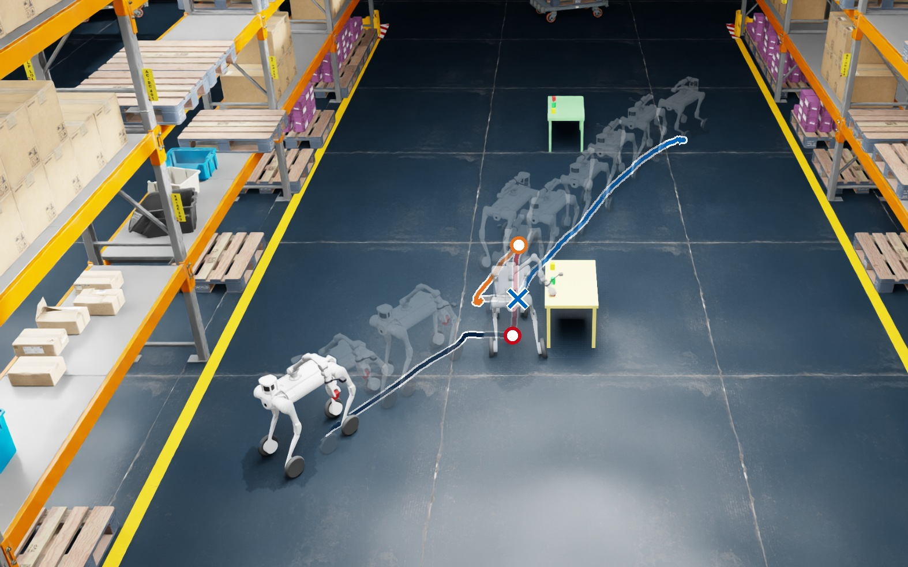

# Application scenarios for a quadruped manipulator in NVIDIA Isaac Sim

A Unitree **B2W** wheeled quadruped with a **Z1** arm and gripper, simulated in NVIDIA Isaac Sim with the sensors
planned for the real robot, and a pipeline that goes from a sentence to a fetched box: *"Pick up the red box on the
yellow table and bring it to me."* DualVLN walks the robot to the named table, Nav2 parks it beside the box, MoveIt
plans the arm's pick around the table and the robot's own body, Nav2 brings the box back, and every episode can be recorded as a LeRobot dataset for training a
whole-body vision-language-action model.



*One episode of the final pipeline as a chronophotograph (see `docs/report.pdf`, Fig. 1).*

Forschungspraktikum at the TUM AVS lab, 2026. The report with all results is [`docs/report.pdf`](docs/report.pdf).

## What is in here

- **The robot.** B2W + Z1 + gripper as one articulation (23 DoF), RealSense D455 (head) and D405 (wrist, on a
  3D-printable holder), Ouster OS0-128 lidar, all publishing to ROS 2. Built by scripts in `tools/`.
- **Controllers.** ETH's walking policy for the real B2W with our stance fine-tune; whole-body RL policies trained in
  Isaac Lab, up to one policy that drives, crouches and reaches a 6D hand target by itself (`policies/`).
- **Scenarios.** Warehouse scenes with one table or three coloured tables, and NVIDIA's hospital: take the named box
  out of the medicine shelf behind the reception desk and put it on the side table; or, with the shelf and table moved
  into the hall in front of the robot (`hospital_hall`), a box on each of three trays -- the robot crouches for the
  low one and stands taller for the high one -- and DualVLN walking to the shelf. And doors (`hospital_doors`): three
  hinged doors with lever handles in a corridor, one painted blue at random; the robot walks to the blue one, grasps
  the lever and turns it (the latch lets go), pushes the door open along its arc and goes into the room. Described by
  scene files (`scenes/`).
- **Pipelines.** Scripted, Nav2 and language (DualVLN) navigation; the side pick planned by **MoveIt 2** (or the
  scripted inverse-kinematics pick, `--arm ik`); delivery.
- **Data.** A recorder for every episode (RGB-D of both cameras, language, 63-D state, whole-body actions, labels) and
  a converter to LeRobot v2.1.
- **Photoreal rooms, two ways.** One command from phone photos to a NuRec scene for Isaac Sim, look only
  (`reconstruction_no_mesh/`); or one command from an iPhone LiDAR recording (Record3D) to a scene with an invisible
  collision mesh, which a robot can drive in (`reconstruction_with_mesh/`). Rooms captured with SpatialAI (Echo-3)
  become the same kind of stage (`scenes/spatialAI/`); `project/scene_tour.py` drives the B2W + Z1 round any of
  them and films it.

## Layout

```
config.example.yaml  machine settings (GPU, paths, ports); setup.sh copies it to config.yaml, which you edit
setup.sh             one-time setup: third-party code at pinned versions, our tasks, images, robot assets
run.py               one entry point for everything below
isaac/               Isaac Sim / Isaac Lab infrastructure: launchers, container settings, Dockerfile
project/             the application: fetch pipeline, live demos, recorder, controllers' glue, Nav2/DualVLN clients
training/            our Isaac Lab tasks (installed into robot_lab by setup.sh) and training helpers
evaluation/          the scripts behind the report's numbers
scenes/              scene files: what is where in the world, which Nav2 map, where the robot starts
policies/            trained checkpoints used by the demos
eth/                 ETH's walking controller and our fine-tuned version
nav2/                Nav2 container, parameters, maps
moveit/              MoveIt 2 container: plans the arm's pick (Z1 MoveIt config, HTTP bridge to the simulator)
vln/                 DualVLN server container
robots_usd/          robot assets (downloaded by setup.sh; too large for git)
tools/               robot asset builders, dataset tools, the reconstruction studies (reconstruction_experiments/)
reconstruction_no_mesh/    phone photos -> photoreal Isaac Sim scene (look only)
reconstruction_with_mesh/  iPhone LiDAR recording(s) -> photoreal scene + collision mesh a robot drives on
scenes/spatialAI/    SpatialAI splat + mesh of a room -> one Isaac stage (splat + invisible collider)
docs/                the report and the development records
renders/, datasets/  outputs of runs (not in git)
repos/               third-party checkouts (not in git; cloned by setup.sh)
```

## Requirements

- Linux with an NVIDIA RTX GPU (developed on an RTX 6000 Ada, 48 GB; driver 570) and Docker with the NVIDIA
  container toolkit. Isaac Sim's requirements apply: about 30 GB for the images.
- Language navigation additionally runs DualVLN next to the simulator: about 21 GB of GPU memory (10 GB in 8-bit).
- `git`, `python3` with PyYAML on the host.

## Setup

```bash
git clone <this repository> && cd <it>
./setup.sh                 # creates config.yaml, clones Isaac Lab 2.3.2 + robot_lab 2.3.2, links our tasks in,
                           # builds the isaac-lab and Nav2 images, gets the robot assets
nano config.yaml           # at least gpu.uuid on a shared machine, livestream.address for remote viewing
./setup.sh --vln           # language navigation: InternNav, the DualVLN image and model weights (~16 GB)
./setup.sh --check         # what is there and what is missing
```

The robot assets are not in git (174 MB): `setup.sh` downloads them from the release
(`ASSETS_URL=<release tarball> ./setup.sh`) or copies them (`./setup.sh --assets-from <folder>`).

## Run

```bash
python3 run.py fetch                     # the final pipeline, headless: DualVLN -> Nav2 -> pick -> (delivery)
python3 run.py fetch --episodes 30 --record my_data      # ... and record 30 episodes
python3 run.py dataset my_data --out my_data             # -> datasets/lerobot/my_data (LeRobot v2.1)
python3 run.py fetch --scene warehouse_one_table --no-vln --no-nav2 --deliver   # scripted drive, one table
python3 run.py fetch --arm ik            # the scripted IK pick instead of MoveIt
python3 run.py fetch --scene hospital_reception --no-vln --video 0 -- --cam scene_follow   # shelf -> side table
python3 run.py fetch --scene hospital_hall --episodes 3 --target green,yellow,red --video 0,1,2   # a box per tray
python3 run.py fetch --scene hospital_doors --episodes 3 --target a,b,c --video 0,1,2   # open the blue door, go in
python3 run.py live fetch                # Isaac Sim window: type tasks ("go to the green table and pick the red box")
python3 run.py live goto_mine            # one whole-body policy: type a hand target "x y z [roll pitch yaw]"
python3 run.py train --task RobotLab-Isaac-RFM-Delta-Sphere-Unitree-B2W-Z1-v0    # RL training
python3 run.py reconstruct home          # phone photos -> photoreal scene (reconstruction_no_mesh/README.md)
python3 run.py reconstruct-mesh <rec>    # LiDAR recording(s) -> scene + collider (reconstruction_with_mesh/README.md)
python3 run.py --help                    # everything else
```

Results land in `renders/fetch/<run>/` (`results.json`, videos, DualVLN logs) and `datasets/raw/<name>/`.
`project/live.sh` (the interactive demos), `isaac/run_script.sh` (any script in the container) and
`isaac/run_train.sh` are the lower-level launchers `run.py` calls.

## Your own environment and task

The robot side is generic: robot, sensors, walking and whole-body controllers, Nav2 and DualVLN clients, recorder.
What changes per environment is written in a scene file:

1. **Scene.** Copy `scenes/warehouse_three_tables.yaml` and change what is where: the environment USD (any Isaac Sim
   stage, e.g. your own building), the tables and their positions, box colours, the drop zone, start poses.
   `python3 run.py fetch --scene my_scene` and `SCENE=my_scene ./project/live.sh fetch` use it. The building's own
   furniture works too: `scenes/hospital_reception.yaml` uses the hospital's shelf and side table (layout `shelf`,
   `scenes/README.md`); `moveit/shelf_reach.py` tells whether the arm can get a box out of a shelf before any run.
2. **Nav2 map.** `./isaac/run_script.sh project/nav2_probe.py --task <the scene's task> --map my_map` builds the
   occupancy map from the scene's colliders into `nav2/maps/` (`--area x0,x1,y0,y1` for a part of a big building);
   put `nav2_map: my_map` in the scene file. Look at the map: it shows the walls a list of furniture misses.
3. **Photoreal look.** A room reconstructed from photos (`reconstruction_no_mesh/`) looks real but has no collision
   geometry, so the robot cannot drive in it: use it for appearance, with colliders from a regular USD. A place
   recorded with an iPhone's LiDAR (`reconstruction_with_mesh/`) gets an invisible collider aligned with the look:
   its `isaac/<name>_robot.usda` is a ground the B2W + Z1 drove a 46 m loop on (`project/scene_tour.py`; the
   SpatialAI office in `scenes/spatialAI/` too, 46 m, 4.5 cm off the route). Using it as a fetch scene's
   environment (Nav2 map, tables) is not tested yet.
4. **A new task** (e.g. opening a door) reuses navigation, docking, recording and the controllers. The manipulation
   skill itself is new code: `project/fetch_box.py` shows the pattern (`pick()`, `deliver()`, `place_moveit()`); splitting it into
   reusable skills and task files is the next step of this repository.

## Results (details in the report)

| Pipeline | Episodes | Picked | Delivered |
|---|---|---|---|
| Scripted side pick + crouch, one table | 72 | 69 | 69 |
| Nav2 parking + delivery, three tables | 12 | 12 | 12 |
| DualVLN + Nav2, language tasks (final) | 30 | 30 | 15/15 |

These are the report's runs, made with the scripted IK pick (`--arm ik`). The MoveIt pick came after the report:

| Pipeline, MoveIt pick | Episodes | Picked | Delivered | Grasp-point error (median) |
|---|---|---|---|---|
| Scripted drive, one table (`--seed 100`; the IK pick on the same episodes: 36/36, 0.2 cm) | 36 | 36 | 36 | 0.3 cm |
| Nav2 parking + delivery, three tables (7 picks from the right, 5 from the left) | 12 | 12 | 12 | 0.25 cm |
| DualVLN + Nav2 + MoveIt, recorded (`--seed 43`) | 3 | 3 | 3 | 0.2 cm |

| Hospital reception: take the named box out of the shelf, put it on the side table (Nav2 + MoveIt) | Episodes | Picked | Placed | Box off its spot (median / max) |
|---|---|---|---|---|
| `--scene hospital_reception --no-vln`, seeds 11 and 12 | 12 | 12 | 12 | 0.65 / 1.5 cm, upright |
| `--scene hospital_hall` (a box per tray, on the side facing the robot; DualVLN first), seeds 81 and 82 | 12 | 12 | 12 | 0.8 / 1.6 cm, upright |

Every drive to the shelf and to the table ended where it should, no falls. The robot crouches 6 cm for the low tray
(green 4/4), stands as usual for the 0.9 m one (yellow 4/4) and 1.8 cm taller for the high one (red 4/4). DualVLN
walked to the shelf every time and handed over to Nav2 within about 1 m of it; Nav2 parked at the box side. What it
took (a box out of reach after the body leaned 3 deg at the shelf, a walk that never started on a Nav2 still coming
up, ...) is in [`moveit/README.md`](moveit/README.md).

| Doors: walk to the blue one, turn its lever, push it open, go in (DualVLN + Nav2 + MoveIt) | Episodes | Lever turned, unlatched | Door opened | In the room |
|---|---|---|---|---|
| `--scene hospital_doors`, seeds 31 and 32, the blue door a, b, c in turn | 12 | 12 | 12 | 12 |
| the same, before the lever was turned back up on letting go (27 Oct) | 12 | 11 | 11 | 11 |

The door pushed open to 64 deg (median), the lever held at -39 deg, grasp 0.25 cm off, docking 2.1 cm, no falls,
78 s an episode. Letting go, the robot turns the lever back up under the hand (to -1.6 deg, median), eases the arm off
it and opens the jaws slowly: the hand moves 2.6 cm (median, at most 5.8) as they open, where the lever let go at
-40 deg snapped up into the jaws and knocked the hand 12-24 cm. DualVLN's walk ended nearest the blue door in 9 of
12 (within 1 m in 3; Nav2 parks from there). The miss on 27 Oct: it walked 17 m the other way, off Nav2's map; a
walk now also ends once it gets 3 m further from the door than it started.

The robot did not fall in any of the more than 800 evaluation episodes. The final 6D whole-body policy reached 10
of 12 test targets 1–3 m away.

## Third-party code and assets

Pinned and fetched by `setup.sh`, not copied here: [Isaac Lab](https://github.com/isaac-sim/IsaacLab) 2.3.2,
[robot_lab](https://github.com/fan-ziqi/robot_lab) 2.3.2 (Apache-2.0; `training/robot_lab_overlay/` adds our
tasks to it), [InternNav](https://github.com/InternRobotics/InternNav) (DualVLN). ETH's walking policy is from
[sru-robot-deployment](https://github.com/leggedrobotics/sru-robot-deployment) (MIT). The robot models are
Unitree's B2W and Z1 descriptions; the RealSense meshes are Intel's (Apache-2.0, `robots_usd/RealSense/`).
